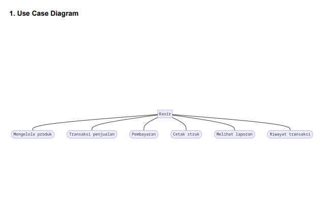
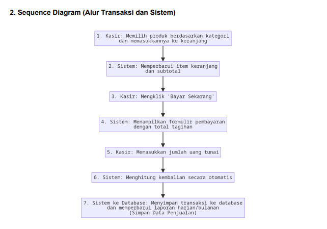
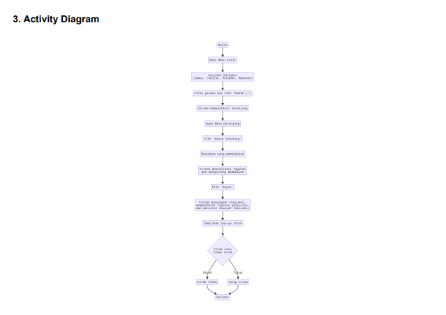
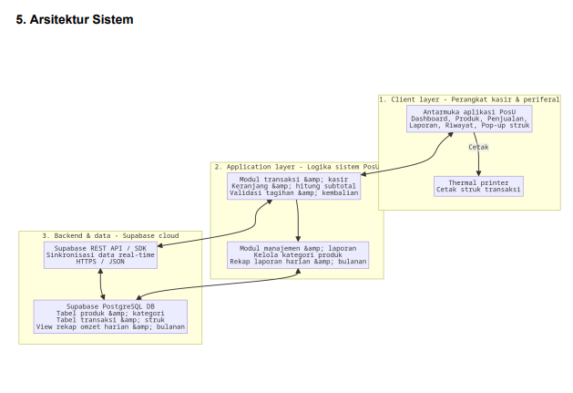

# 📚 Tugas Mata Kuliah: Analisis & Pengujian Sistem IF7A

**Mata Kuliah:** Analisis & Pengujian Sistem  
**Ketua Kelompok (Project Manager):** Aenur Alif - 23EO10033  
**Anggota:**  
- Fikri Amarulloh Tyto Pratama - 23EO10050 (Activity Flow & Logic System Analyst)  
- Fendi Candra Ramadhan - 23EO10052 (Backend & Database Engineer)  
- Yokkie Aufa Safarraz - 23EO10011 (UI/UX Designer & Frontend)  
- Ariz Abiyyu - 23EO10018 (QA Tester & Information Architect)  

---

## 📝 Deskripsi Proyek (20 poin)
Repositori ini berisi artefak, dokumen, dan kode yang berkaitan dengan tugas mata kuliah Analisis & Pengujian Sistem. 

Proyek ini adalah **Sistem Kasir Pintar (PosU)**, yaitu sebuah aplikasi kasir digital yang dirancang untuk membantu pengelolaan transaksi bisnis kecil dan kafe menjadi lebih mudah dan rapi. Sistem ini memiliki kapabilitas utama meliputi:
1. Manajemen Produk
2. Alur Penjualan (Kasir Cepat & Perhitungan Otomatis)
3. Laporan Harian & Bulanan
4. Riwayat Transaksi

---

## 📝 Desain Proyek (Unified Modeling System) (20 poin)

### 1. Use Case Diagram
Menggambarkan interaksi **Aktor Kasir** dengan sistem. Kasir memiliki wewenang untuk melakukan 6 fungsi utama: mengelola produk, transaksi penjualan, pembayaran, cetak struk, melihat laporan, dan melihat riwayat transaksi.

### 2. Sequence Diagram (Alur Transaksi & Sistem)
Menjelaskan alur komunikasi berurutan antara **Kasir**, **Sistem**, dan **Database**. Dimulai dari kasir memilih produk, sistem memperbarui keranjang, proses input uang dan hitung kembalian otomatis, hingga sistem menyimpan data transaksi ke database.

### 3. Activity Diagram (Alur Kerja Sistem)
Menjabarkan alur kerja (*workflow*) kasir mulai dari membuka menu, menjelajahi kategori produk, memvalidasi tagihan pembayaran, mencetak atau menutup struk, hingga proses selesai.

---

## 📝 Arsitektur Proyek (Unified Modeling System) (20 poin)
Sistem PosU menggunakan pendekatan arsitektur yang terbagi menjadi tiga lapisan utama:
1. **Client Layer (Perangkat Kasir & Periferal):** Berisi antarmuka aplikasi PosU (Dashboard, Produk, Penjualan, Laporan) yang berinteraksi langsung dengan pengguna, serta terhubung dengan perangkat keras berupa *Thermal Printer* untuk mencetak struk.
2. **Application Layer (Logika Sistem PosU):** Menangani logika bisnis yang terbagi menjadi *Modul Transaksi & Kasir* (menghitung subtotal dan validasi kembalian) serta *Modul Manajemen & Laporan* (mengelola kategori produk dan rekap penjualan).
3. **Backend & Data (Supabase Cloud):** Sistem menggunakan layanan Supabase REST API/SDK dengan protokol HTTPS/JSON untuk sinkronisasi data *real-time*. Seluruh data tabel produk, transaksi, dan *view* omzet disimpan di dalam basis data Supabase PostgreSQL.

---

## 📝 Tech Stack (20 poin)
Berdasarkan arsitektur yang digunakan, berikut adalah *tech stack* utama sistem PosU:
- **Frontend (FE):** React + Vite (Antarmuka Aplikasi PosU)
- **Backend Service / BaaS:** Supabase (REST API / SDK)
- **Database:** Supabase PostgreSQL
- **Perangkat Ekstra:** Thermal Printer (untuk cetak struk)

---

## 📝 Upload Project di Github & Demonstrasi UTS (20 poin)
- Proyek ini diunggah dan dikelola melalui repositori GitHub ini oleh **Ketua Kelompok**.
- Seluruh anggota siap untuk mendemonstrasikan sistem dan dokumentasi ini pada waktu UTS yang telah ditentukan.